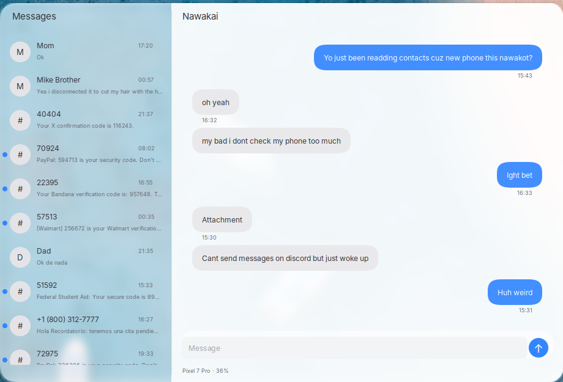

# Messages

Cutefish's messaging app: your phone's text messages on the desktop, in a
window that belongs in macOS Tahoe — a glass body, a frosted sidebar, and the
conversation on its own paper.



Texts arrive over Wi-Fi. Nothing of KDE runs on the desktop: the app speaks the
published KDE Connect protocol itself, so the only thing to install on the
phone is the normal KDE Connect app.

## What it does

- Conversations and full message history from the phone, newest first.
- Contact names from the phone's address book, with numbers formatted when
  there is no match.
- MMS pictures, first as the preview the phone sends with the message and then
  at full size, fetched over the protocol's payload channel and cached.
- Sending through the phone's SIM, with the conversation moving to the top as
  it does on the phone.
- Unread dots, wrapped bubbles that hug their text, and timestamps where a
  conversation breaks.
- Pairing from either side, with the code both screens show; the phone pins the
  app's certificate after that.

## Requirements

- Cutefish Toolkit (`CutefishToolkit`), C++20, OpenSSL.
- An Android phone on the same network with KDE Connect installed.
- The compositor's glass for the window backdrop; without it the app still
  works over a plain background.

## Build

```sh
cmake -S . -B build -G Ninja -DCMAKE_BUILD_TYPE=Release
ninja -C build
build/cutefish-messages
```

`--demo` shows the window with made-up conversations, for working on the
interface without a phone.

## Pairing

The phone finds the computer by broadcast; the computer listens on TCP 1716.
Open KDE Connect on the phone, pick the computer, and choose *Request pairing*.
Both sides show the same eight characters, which is the first four bytes of
SHA-256 over the two certificates and the request's timestamp, in uppercase
hex.

See `docs/protocol-notes.md` for the packet details, the capabilities the phone
requires before it answers, and the mistakes worth not repeating.

## Status

Android over the KDE Connect protocol is in use daily. The iPhone backend
(BlueFerry) is the next piece, behind the same window.

## Licence

BSD-3-Clause. See `LICENSE`.
